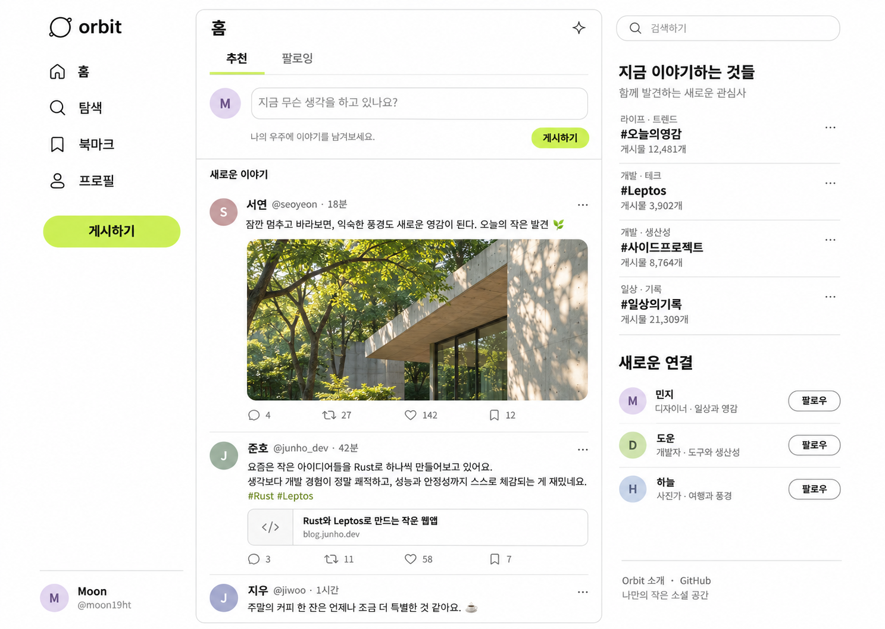

# Orbit 디자인과 검증

## 방향

X의 왼쪽 탐색·가운데 피드·오른쪽 발견 영역을 갖는 한국어 개인용 마이크로블로그입니다. 사용자 선택에 따라 로그인·공용 백엔드 없이 GitHub Pages와 브라우저 저장으로 동작합니다.

## 설계 시안

- 배경 `#ffffff`, 본문 `#191b1a`, 보조 문구 `#818680`, 액션 `#d3f36b`
- 최대 1240px의 3열 화면, 얇은 구분선, 개방형 우측 목록, 16px 미디어 모서리
- 한국어 시스템 산세리프, 굵은 제목과 담백한 본문, 일관된 선형 SVG 아이콘
- 1100px 이하 발견 영역 숨김, 900px 이하 좁은 탐색 레일, 600px 이하 하단 탐색
- 키보드 포커스, 본문 바로가기, 이름이 있는 입력과 아이콘 버튼, 줄어든 모션 설정 지원

시안은 built-in Imagegen으로 생성했습니다. 프롬프트는 한국어 X형 3열 앱, Orbit 이름, 흰색·차콜·연두색, 홈·탐색·북마크·프로필, 글 작성창, 건축 사진 게시글, 트렌드와 팔로우 목록을 지정했습니다. UI 자체는 모두 Leptos와 CSS이며 이미지 화면을 UI로 사용하지 않습니다.

`assets/architecture.jpg`도 built-in Imagegen으로 생성했습니다. 프롬프트: “A wide editorial architecture photograph: quiet modern concrete gallery with dark glass windows on the right, sunlit green trees on the left, leaf shadows on natural concrete, serene forest afternoon, rich greens, no people, no text, no logos, no overlays.” 생성한 PNG를 웹용 JPEG로 변환했습니다.

## 의도적인 시안 차이

- 트렌드의 큰 가상 게시글 수 대신 현재 브라우저의 실제 검색 결과 수를 표시합니다.
- 팔로우 추천은 예시 피드에 실제 글이 있는 서연·도윤·준호로 맞췄습니다.
- 예시 반응 수와 문구는 코드의 seed 데이터에 맞췄으며, 답글 수는 실제 저장된 답글 수입니다.
- 링크 미리보기는 가상 도메인 대신 공식 Leptos 문서로 연결합니다.
- 브라우저 저장 데모라는 안내, 입력 제한·저장 오류·빈 목록·내 프로필·답글 상태를 추가했습니다.
- 사진은 같은 구도의 별도 생성 자산입니다. 마우스로 조작 가능한 기능만 표시합니다.

## Craft Anything

설치된 Craft Anything 0.3.0 Windows portable CLI의 `web_site_open` → `web_site_capture` 흐름을 사용합니다. Clean room은 대상 페이지의 공개 화면과 디자인 단서를 관찰합니다.

`https://x.com/explore`와 `https://x.com`은 `net::ERR_HTTP_RESPONSE_CODE_FAILURE`로 열리지 않았습니다. X 원본을 직접 관찰했다는 검증 주장은 하지 않습니다. 구현은 일반적인 마이크로블로그 구조와 위 시안을 기준으로 합니다.

## 검증

2026-11-07 로컬 검증:

- `cargo fmt --all -- --check`, `cargo clippy --locked --all-targets -- -D warnings`, `cargo test --locked` 통과. 단위 테스트 6개.
- 릴리스 WASM 생성 성공. `strip=true`가 WASM 기능 메타데이터를 제거하는 문제를 해결해 wasm-opt 최적화도 통과했습니다.
- 내장 브라우저에서 글 작성, 메뉴 이동 시 초안 유지, 281자 입력 차단, 답글, 좋아요, 재게시, 북마크, 새로고침 후 저장 복원, 검색, 팔로잉 피드를 확인했습니다.
- 모바일 탐색에서 팔로우 관리 및 프로필의 브라우저 저장 안내를 확인했습니다.
- 버튼 `aria-pressed`와 답글 `aria-expanded`가 올바른 문자열로 전달되도록 브라우저 검증 후 수정했습니다.
- 내장 브라우저의 네이티브 확인창 자동화가 멈춰 삭제 확인을 앱 내부 확인 영역으로 변경했습니다. Craft의 독립 브라우저에서 게시 → 삭제 확인 → 취소 후 유지 → 재확인 → 삭제 → 새로고침 후 삭제 유지의 8단계를 모두 통과했습니다.
- Craft Clean room으로 1440·768·390·1488px 캡처. 모든 폭에서 가로 넘침 0, 이름 없는 조작 요소 0, alt 없는 이미지 0.
- Craft 로컬 walkthrough를 1488×1056px로 실행하고 페이지 오류와 콘솔 실행 오류가 없음을 확인했습니다. Chromium의 WASM preload integrity 안내 경고는 기능에 영향을 주지 않았습니다.
- 로컬 최종 확인은 Trunk 개발용 WebSocket 삽입을 끈 릴리스 파일로 진행했습니다. 배포는 `trunk build --release` 산출물을 사용합니다.

### 시안 대비 기록

시안과 최신 데스크톱·모바일 화면을 `view_image`로 직접 대조했습니다.

| 항목 | 시안과 구현 비교 | 반영 |
| --- | --- | --- |
| 화면 구성 | 왼쪽 탐색, 가운데 피드, 오른쪽 발견 목록 | 3열·최대 폭·16px 상단 여백 유지 |
| 색상 | 흰 배경, 연두색 버튼, 짙은 본문 | 색상 유지, 작은 회색 문구 대비를 4.85:1로 보완 |
| 글꼴과 위계 | 굵은 탐색·제목, 담백한 한국어 본문 | 시스템 한국어 글꼴과 공통 크기 사용 |
| 아이콘 | 얇은 선형 아이콘과 원형 아바타 | 일관된 SVG와 상태별 접근성 표기 |
| 미디어 | 자연광 건축 사진, 둥근 모서리 | 자체 생성 JPEG, 데스크톱 522×251px, 모바일 비율 조절 |
| 문구 | 메뉴·홈·작성창·발견 제목 | 주요 문구 유지, 위의 의도적 차이만 적용 |
| 반응형 | 데스크톱 중심 구조의 모바일 확장 | 하단 메뉴·글쓰기·팔로우 관리, 가로 넘침 없음 |

상단 문구 대조에서는 위의 명시된 데모 안내·실제 집계·예시 콘텐츠 차이 외에 누락을 발견하지 않았습니다. 최종 화면은 이 의도적 차이를 포함한 디자인 방향에 맞게 검증했습니다. 실기기 Safari와 보조공학 기기의 직접 검사는 수행하지 않았습니다.
